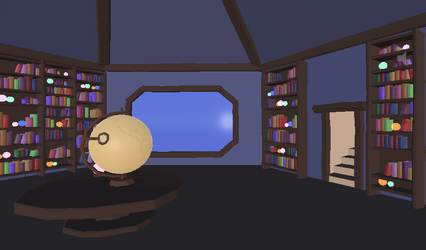
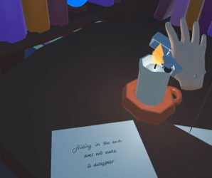
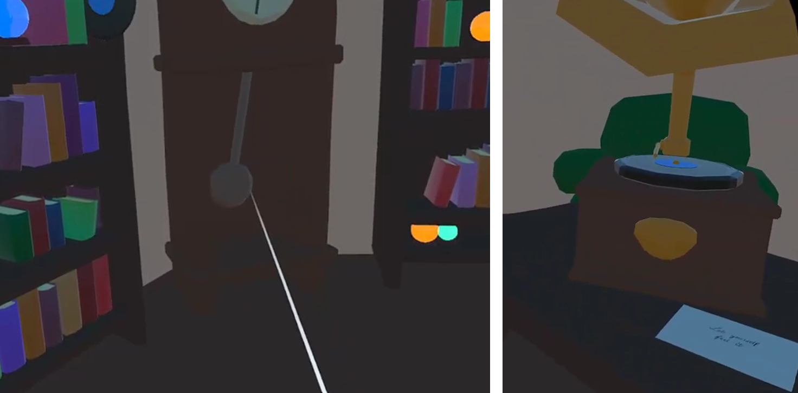

# The Library of Lost Memories
### A Narrative VR Experience | Unity & Blender

*Some memories are buried for a reason. But what do we lose when we forget them?*

**The Library of Lost Memories** is a symbolic VR exploration experience set inside a mysterious, two-floor library representing the protagonist's mind.

The library has fallen into darkness and silence. After burying a painful memory, the protagonist has also lost part of himself, leaving the space empty and frozen in time.

Through a sequence of small, meaningful interactions, the player gradually brings the library back to life. Lighting a candle, discovering a hidden passage, restarting a clock, and playing an old record become steps toward remembering and accepting what was left behind.

Rather than a traditional puzzle game, the project is designed as a **reflective, atmospheric experience**, where the environment itself tells the story.

**[▶ Watch Demo](https://drive.google.com/file/d/1uaTOGjeX20z83SDYTWTkk-sSVx4dPHBe/view?usp=sharing)**

## Experience & Interactions

The experience follows a gradual transition from darkness to light, stillness to movement, and silence to music.

Each interaction has both a practical effect on the environment and a symbolic role in the narrative.

- **Light the candle:** Pick up a lighter and bring it close to the candle to illuminate the surrounding lanterns, revealing the first part of the library.
- **Discover the hidden passage:** Touch a floating, glowing book to trigger a voice fragment and open a moving bookshelf.
- **Reconnect with the world:** Interact with a globe to uncover another fragment of the protagonist's thoughts.
- **Set time in motion:** Touch the frozen pendulum to start the clock's movement, animate its hands, and introduce ticking sounds.
- **Bring back the music:** Place a vinyl record onto the gramophone to start the music and trigger the final environmental transformation.

The journey leads to a hidden room containing the final book, representing the memory the protagonist has tried to forget.

The experience does not end with a conventional victory. Its conclusion is about **acceptance and emotional reconnection**.

## Design & Implementation

### Environmental Storytelling

One of the main goals was to communicate a story through the environment rather than relying on traditional dialogue, objectives, or UI elements.

The library changes in response to the player's actions: lights appear, furniture moves, clocks begin ticking, music fills the space, and particles illuminate the final room.

These changes serve as **diegetic feedback**, helping players understand their progress while preserving the atmosphere.

Short first-person voice fragments and written messages were introduced during development to make the metaphorical narrative easier to follow without explicitly explaining its meaning.

### VR Interaction & Navigation

The experience was developed in **Unity**, using the **XR Interaction Toolkit** and **OpenXR**.

It combines object grabbing, proximity-based triggers, touch interactions, and socket-based placement with environmental animations and audio responses.

Teleportation-based locomotion allows the player to explore both floors, including the staircase, without continuous artificial movement. The layout and object placement were tested from the headset perspective to support reachability, scale, and navigation.

### 3D Modelling & Atmosphere

All 3D models were created in **Blender**, following a stylised low-poly direction with simple geometry, readable silhouettes, and a consistent visual language.

The library uses modular bookshelves, books, furniture, and architectural elements, while more attention was given to symbolic objects such as the clock, gramophone, candle, and books.

Lighting, emissive materials, animation, particles, and sound design work together to create a gradual emotional transformation.

The soundscape moves from quiet ambience and isolated interaction sounds to ticking clocks and, finally, music. Original first-person narration was generated using ElevenLabs, while sound effects and music were sourced from Freesound.

## Project Scope & Development Notes

This project was developed individually for the **Virtual and Augmented Reality** unit at **Monash University (2026)**.

The focus was on creating a cohesive narrative VR environment, combining interaction design, original 3D assets, spatial storytelling, and audiovisual feedback.

Several interactions evolved during development to improve feasibility and reliability. For example, the globe's original rotation puzzle was replaced with a simpler touch interaction, and the final sequence was redesigned around lighting, particles, music, and the opening of the hidden room rather than a physically opening book.

The submitted experience implements the main narrative sequence, although some interactions still require further headset testing and refinement. The project should therefore be considered an academic VR prototype rather than a fully polished release.

## Tools & Technologies

- **Engine:** Unity
- **Programming:** C#
- **VR:** XR Interaction Toolkit 2.6.4, OpenXR 1.14.3
- **3D Modelling:** Blender
- **Animation & Effects:** Unity Animation, Timeline, particle systems, emissive materials
- **Audio:** ElevenLabs (voice-over), Freesound (sound effects and music)

## Credits

All 3D assets were modelled for this project in Blender.

Voice-over text was written specifically for the experience and generated using an ElevenLabs preset voice. Sound effects and music were obtained from Freesound.

The complete audio source references are documented in the original project report.